# KloudKIT • hubd

> 🛰️ Mission control for your agents

hubd keeps your agents' todos, knowledge and machines in one place, and serves them to
Claude Code over MCP. Machines connect through [hubridge](https://github.com/kloudkit/hubridge).

## Run

hubd needs PostgreSQL 18 or newer.

```bash
docker run --rm -e HUBD_DATABASE_URL=postgres://… ghcr.io/kloudkit/hubd migrate
docker run -d -p 8080:8080 -e HUBD_DATABASE_URL=postgres://… \
  -e HUBD_PUBLIC_URL=https://hubd.example.com ghcr.io/kloudkit/hubd
```

## Connect a machine

```bash
docker run --rm -e HUBD_DATABASE_URL=postgres://… -e HUBD_PUBLIC_URL=https://hubd.example.com \
  ghcr.io/kloudkit/hubd client invite laptop
```

This prints a one-line install command, valid for 15 minutes. Run it on the machine.

For a script or another client, the `client create <name>` command prints a token to send as
`Authorization: Bearer <token>`; `client list` and `client revoke <name>` manage them.

## Configure

Set these in the environment, or in a `hubd.yaml` (named by `HUBD_CONFIG`); the environment
wins. Any variable also reads from a file with a `_FILE` suffix, for secrets.

| Variable | Default | |
|---|---|---|
| `HUBD_DATABASE_URL` | required | the Postgres connection string |
| `HUBD_PUBLIC_URL` | | where machines reach hubd |
| `HUBD_HOST`, `HUBD_PORT` | `127.0.0.1`, `5181` (`0.0.0.0`, `8080` in the image) | where hubd listens |
| `HUBD_ALLOWED_HOSTS` | | more host names hubd answers to, comma separated |
| `HUBD_MIGRATE` | `false` | migrate on start |
| `HUBD_LOG_LEVEL`, `HUBD_LOG_FORMAT` | `info`, `text` (`json` in the image) | |
| `HUBD_MAX_BODY_BYTES` | 10 MiB | largest request body |
| `HUBD_REQUEST_TIMEOUT_SECONDS` | `30` | |
| `HUBD_AUTH` | `token` | `token` (client tokens only), `oidc` (sign-in for the web page plus client tokens) or `none` |
| `HUBD_OIDC_ISSUER`, `HUBD_OIDC_CLIENT_ID`, `HUBD_OIDC_CLIENT_SECRET` | | the OIDC provider, when `HUBD_AUTH=oidc`; its redirect URI is `<HUBD_PUBLIC_URL>/auth/callback` |
| `HUBD_AUTH_ALLOW` | | who may sign in: emails or groups, comma separated |
| `HUBD_OIDC_SCOPES`, `HUBD_OIDC_GROUPS_CLAIM` | `openid email profile`, `groups` | |
| `HUBD_SESSION_SECRET` | | at least 32 characters; encrypts the sign-in cookie |
| `HUBD_SESSION_DAYS` | `30` | how long a sign-in lasts |
| `HUBD_STORAGE_DIR` | | where attachments are kept; without it (or an S3 bucket) attachments are off |
| `HUBD_STORAGE`, `HUBD_S3_BUCKET`, `HUBD_S3_ENDPOINT`, `HUBD_S3_PREFIX`, `HUBD_S3_REGION` | `volume` | keep attachments in S3 instead (`HUBD_STORAGE=s3`, credentials in `AWS_*`) |
| `HUBD_FILE_MAX_BYTES` | 25 MiB | largest attachment |
| `HUBD_REVISION_RETENTION_DAYS` | unset (keep all) | after this many days, a nightly job squashes each record's older revisions into one baseline |
| `HUBD_PLUGIN_<ID>_<KEY>` | | a plugin's setting |

`GET /health` tells whether hubd is up; `GET /health?ready` also checks the database and
the job queue.

## Develop

```bash
pnpm install
cp .env.example .env    # point HUBD_DATABASE_URL at a Postgres
pnpm migrate && pnpm dev
pnpm --filter @hubd/web dev   # the web page on :5180, against hubd on :5181
pnpm test               # needs Docker
```

## License

Released under the [**MIT License**](https://github.com/kloudkit/hubd/blob/main/LICENSE),
**except** the [`brand/`](https://github.com/kloudkit/hubd/tree/main/brand) directory.

The hubd and KloudKIT logos, icons and other brand assets are proprietary and
**all rights reserved**; see [`brand/LICENSE`](https://github.com/kloudkit/hubd/blob/main/brand/LICENSE).
